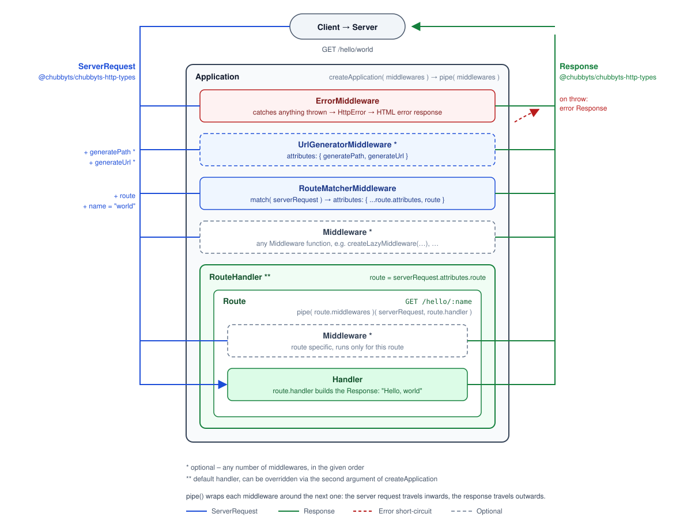

# chubbyts-framework

[](https://github.com/chubbyts/chubbyts-framework/actions/workflows/ci.yml)
[](https://coveralls.io/github/chubbyts/chubbyts-framework?branch=master)
[](https://dashboard.stryker-mutator.io/reports/github.com/chubbyts/chubbyts-framework/master)
[](https://www.npmjs.com/package/@chubbyts/chubbyts-framework)

[](https://sonarcloud.io/dashboard?id=chubbyts_chubbyts-framework)
[](https://sonarcloud.io/dashboard?id=chubbyts_chubbyts-framework)
[](https://sonarcloud.io/dashboard?id=chubbyts_chubbyts-framework)
[](https://sonarcloud.io/dashboard?id=chubbyts_chubbyts-framework)
[](https://sonarcloud.io/dashboard?id=chubbyts_chubbyts-framework)
[](https://sonarcloud.io/dashboard?id=chubbyts_chubbyts-framework)
[](https://sonarcloud.io/dashboard?id=chubbyts_chubbyts-framework)
[](https://sonarcloud.io/dashboard?id=chubbyts_chubbyts-framework)
[](https://sonarcloud.io/dashboard?id=chubbyts_chubbyts-framework)
[](https://sonarcloud.io/dashboard?id=chubbyts_chubbyts-framework)
[](https://sonarcloud.io/dashboard?id=chubbyts_chubbyts-framework)

## Description

A minimal, highly [performant][2] middleware [PSR-15][3] inspired function based micro framework built with as little complexity as possible, aimed primarily at those developers who want to understand all the vendors they use.



## Requirements

 * node: 22
 * [@chubbyts/chubbyts-dic-types][4]: ^2.3.1
 * [@chubbyts/chubbyts-http-error][5]: ^3.5.1
 * [@chubbyts/chubbyts-http-types][6]: ^4.1.0
 * [@chubbyts/chubbyts-log-types][7]: ^3.3.1
 * [@chubbyts/chubbyts-throwable-to-error][8]: ^2.3.4

## Installation

Through [NPM](https://www.npmjs.com) as [@chubbyts/chubbyts-framework][1].

```sh
npm i \
  @chubbyts/chubbyts-framework-router-path-to-regexp@^4.0.0 \
  @chubbyts/chubbyts-framework@^4.1.1 \
  @chubbyts/chubbyts-http@^3.1.0
```

## Usage

```ts
import { createPathToRegexpMatch }
  from '@chubbyts/chubbyts-framework-router-path-to-regexp/path-to-regexp-router';
import { createResponseFactory, createBodyFactory } from '@chubbyts/chubbyts-http/message-factory';
import { createApplication } from '@chubbyts/chubbyts-framework/application';
import { createErrorMiddleware }
  from '@chubbyts/chubbyts-framework/middleware/error-middleware';
import { createRouteMatcherMiddleware }
  from '@chubbyts/chubbyts-framework/middleware/route-matcher-middleware';
import { createGetRoute } from '@chubbyts/chubbyts-framework/router/route';
import { createRoutesByName } from '@chubbyts/chubbyts-framework/router/routes-by-name';

const bodyFactory = createBodyFactory();
const responseFactory = createResponseFactory(bodyFactory);

const app = createApplication([
  createErrorMiddleware(responseFactory, bodyFactory, true),
  createRouteMatcherMiddleware(
    createPathToRegexpMatch(
      createRoutesByName([
        createGetRoute<{ name: string }>({
          path: '/hello/:name',
          name: 'hello',
          handler: async (serverRequest) => {
            const response = responseFactory(200);

            return {
              ...response,
              headers: { ...response.headers, 'content-type': ['text/plain'] },
              body: bodyFactory(`Hello, ${serverRequest.attributes.name}`),
            };
          },
        }),
      ]),
    ),
  ),
]);
```

### Application builder

A facade around `createApplication` / `createErrorMiddleware` / `createRouteMatcherMiddleware` / `createRoute` /
`createGroup`: pure construction sugar, the returned handler is the very same middleware pipe as with the
explicit composition: error middleware first, app middlewares, route matcher middleware last.

The first argument holds all the dependencies (`ApplicationBuilderDependencies`), the second one the app middlewares
(an empty array if there are none).

```ts
import { createPathToRegexpMatch as createMatch }
  from '@chubbyts/chubbyts-framework-router-path-to-regexp/path-to-regexp-router';
import { createResponseFactory, createBodyFactory } from '@chubbyts/chubbyts-http/message-factory';
import { createApplicationBuilder } from '@chubbyts/chubbyts-framework/facade';

const bodyFactory = createBodyFactory();
const responseFactory = createResponseFactory(bodyFactory);

const application = createApplicationBuilder(
  {
    createMatch,
    responseFactory,
    bodyFactory,
    // optional: debug, logger, mapToHttpError, createGeneratePath, createGenerateUrl
  },
  [corsMiddleware],
)
  .get('/ping', 'ping', pingHandler)
  .get('/openapi', 'openapi', openApiHandler)
  .group('/api/pets', [acceptNegotiationMiddleware, apiErrorMiddleware], (pets) =>
    pets
      .get('', 'pet_list', petListHandler)
      .post('', 'pet_create', [contentTypeNegotiationMiddleware], petCreateHandler)
      .get('/:id', 'pet_read', petReadHandler)
      .put('/:id', 'pet_update', [contentTypeNegotiationMiddleware], petUpdateHandler)
      .delete('/:id', 'pet_delete', petDeleteHandler),
  )
  .build();
```

### Server

#### node

Running the application via the standard node http implementation.

```sh
npm i @chubbyts/chubbyts-http-node@^1.0.0
```

Check the [Usage][10] section.

#### uWebSockets

Running the application via the uWebSockets http implementation.

```sh
npm i @chubbyts/chubbyts-http-uwebsockets@^1.0.0
```

Check the [Usage][11] section.

## Handler's / Middleware's

 * [@chubbyts/chubbyts-http-api][20]
 * [@chubbyts/chubbyts-http-cors][21]
 * [@chubbyts/chubbyts-http-multipart][22]
 * [@chubbyts/chubbyts-http-oidc][23]
 * [@chubbyts/chubbyts-http-rate-limit][24]
 * [@chubbyts/chubbyts-http-static-file][25]
 * [@chubbyts/chubbyts-http-trusted-proxy][26]

## Skeleton

 * [chubbyts/chubbyts-framework-skeleton][30]
 * [chubbyts/chubbyts-petstore][31]

## Copyright

2026 Dominik Zogg

[1]: https://www.npmjs.com/package/@chubbyts/chubbyts-framework
[2]: https://web-frameworks-benchmark.netlify.app/result
[3]: https://www.php-fig.org/psr/psr-15/#2-interfaces
[4]: https://www.npmjs.com/package/@chubbyts/chubbyts-dic-types
[5]: https://www.npmjs.com/package/@chubbyts/chubbyts-http-error
[6]: https://www.npmjs.com/package/@chubbyts/chubbyts-http-types
[7]: https://www.npmjs.com/package/@chubbyts/chubbyts-log-types
[8]: https://www.npmjs.com/package/@chubbyts/chubbyts-throwable-to-error

[10]: https://www.npmjs.com/package/@chubbyts/chubbyts-http-node#usage
[11]: https://www.npmjs.com/package/@chubbyts/chubbyts-http-uwebsockets#usage

[20]: https://www.npmjs.com/package/@chubbyts/chubbyts-http-api
[21]: https://www.npmjs.com/package/@chubbyts/chubbyts-http-cors
[22]: https://www.npmjs.com/package/@chubbyts/chubbyts-http-multipart
[23]: https://www.npmjs.com/package/@chubbyts/chubbyts-http-oidc
[24]: https://www.npmjs.com/package/@chubbyts/chubbyts-http-rate-limit
[25]: https://www.npmjs.com/package/@chubbyts/chubbyts-http-static-file
[26]: https://www.npmjs.com/package/@chubbyts/chubbyts-http-trusted-proxy

[30]: https://github.com/chubbyts/chubbyts-framework-skeleton
[31]: https://github.com/chubbyts/chubbyts-petstore
